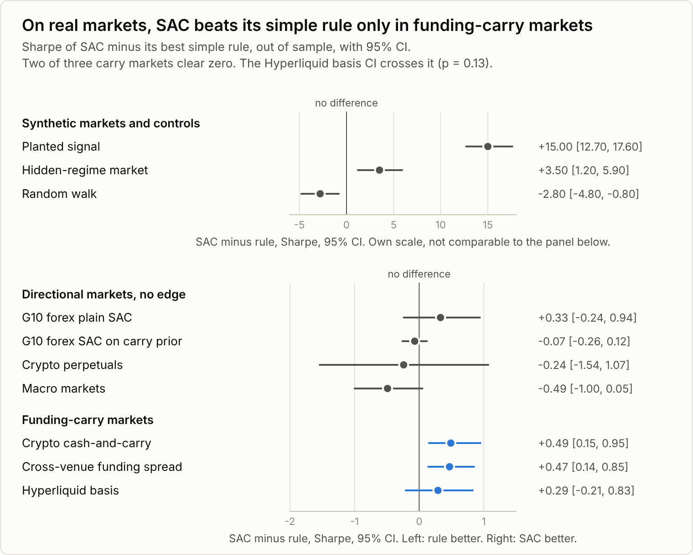
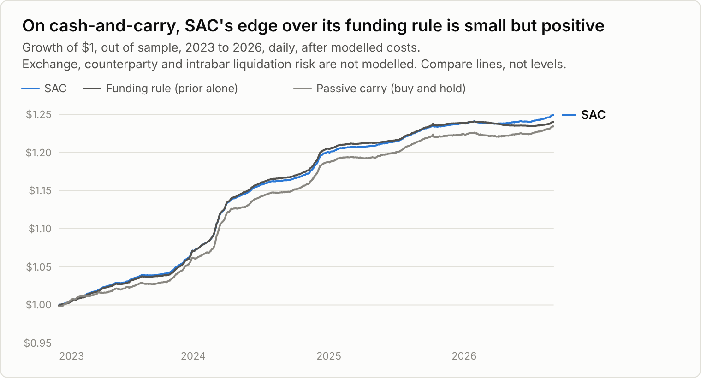
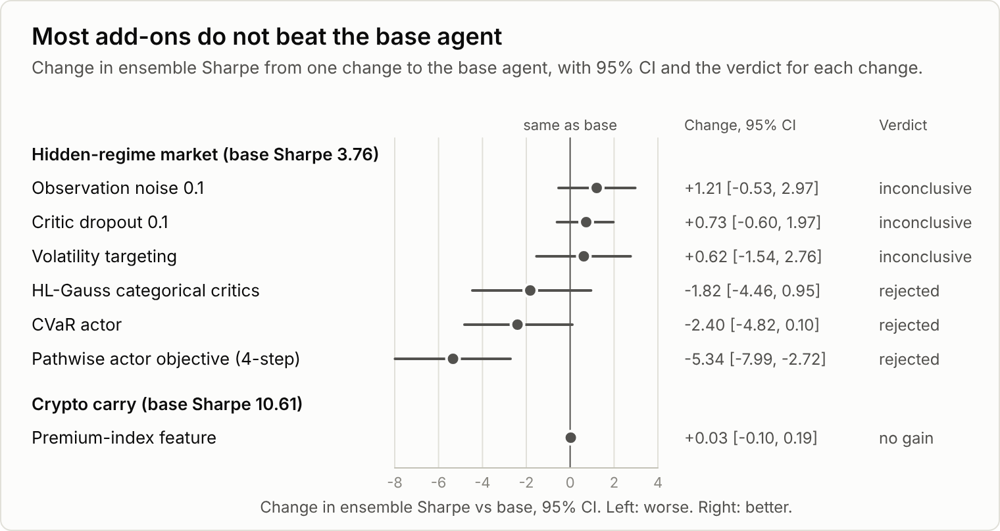

# Results

Results as of 2026-10-13. Every number here is out of sample: the test windows were not used to
train the agent or to pick its settings.

## What we found

- **Where the answer is known, the agent finds it.** On synthetic markets with a planted signal,
  the agent reaches a Sharpe ratio of 15.07. Buy-and-hold reaches 0.04.
- **On random walks, with no edge to find, the agent does worse than buy-and-hold.** Its Sharpe
  ratio is -1.47 against 1.37 for buy-and-hold, and its deflated Sharpe ratio is 0.004.
- **On real directional markets, no edge.** Forex, forex carry and crypto perpetual futures all
  show differences from the simple rules whose 95% intervals include zero. The highest deflated
  Sharpe ratio in these rows is 0.37.
- **On carry trades, a small gain over the funding rule.** Two of three carry universes show a
  difference whose 95% interval sits above zero: crypto cash-and-carry (+0.49 Sharpe) and the
  cross-venue funding spread (+0.47). The Hyperliquid basis gain (+0.29) is not statistically
  distinguishable from zero.
- **Changes to the agent did not produce a clear win.** On the hidden-regime market, three
  changes raised the Sharpe ratio with intervals that include zero. Three lowered it.

## How to read these numbers

> **How to read these numbers**
>
> - [Sharpe ratio](glossary.md#sharpe-ratio): average return divided by its volatility, after all
>   costs, annualized from per-bar returns. Higher is better.
> - 95% CI: the [bootstrap](glossary.md#bootstrap) interval for the Sharpe difference between the
>   agent and the reference rule. If the interval lies entirely above zero, the agent beat the
>   rule in this test.
> - [DSR](glossary.md#dsr): the probability that a Sharpe ratio is real after counting every
>   variant tried, shown in brackets. A DSR of 0.5 means the Sharpe ratio equals the luck
>   benchmark for that many trials. Lower values fall short of it.

Carry Sharpe levels come from a model. They do not include exchange or counterparty risk, so only
comparisons between strategies on the same data mean anything here.

## Synthetic controls

Synthetic markets have a known answer. The planted-signal market should show an edge, and the
random walk should not. The hidden-regime market has changing volatility and fat-tailed shocks.

| Market | SAC Sharpe | Best simple rule | SAC minus rule, 95% CI | DSR (trials) |
| --- | --- | --- | --- | --- |
| Planted signal, 6 synthetic markets, 1 year hourly | 15.07 | buy-and-hold 0.04 | +15.0 [12.7, 17.6] | 1.000 (5) |
| Random walk, 1 year hourly | -1.47 | buy-and-hold 1.37 | -2.8 [-4.8, -0.8] | 0.004 (5) |
| Hidden-regime market, 1 year hourly | 3.76 | buy-and-hold 0.28; sign oracle 8.61 | +3.5 [1.2, 5.9] | 0.89 (15) |

The sign oracle reads each synthetic market's true next expected return and trades its sign. It
shows the ceiling a rule could reach on that market. It is not a strategy.

The planted signal is found with a deflated Sharpe ratio of 1.000. On the random walk, the agent
loses to buy-and-hold. On the hidden-regime market, the agent beats buy-and-hold with an interval
that stays above zero.

## Real markets, directional

These markets have no known answer. The agent is compared with the best simple rule for each
market.

| Market | SAC Sharpe | Best simple rule | SAC minus rule, 95% CI | DSR (trials) |
| --- | --- | --- | --- | --- |
| G10 forex, 7 pairs, plain SAC, daily, 12.7 years (2014-2026) | 0.35 | buy-and-hold 0.01 | +0.33 [-0.24, 0.94] | 0.37 (10) |
| G10 forex, SAC on a carry prior | 0.10 | carry rule 0.16 | -0.07 [-0.26, 0.12] | 0.11 (10) |
| Crypto perpetual futures, 10 coins, daily, 3.7 years (2023-2026) | 0.41 | trend 0.64 | -0.24 [-1.54, 1.07] | 0.21 (10) |

All three intervals include zero, so no difference from the simple rule is established.

## Real markets, carry

A [carry trade](glossary.md#carry-trade) earns a premium for holding a position. In these rows the
premium is the [funding rate](glossary.md#funding-rate) on a perpetual future. The agent learns a
residual on top of the funding rule. The "rule" column is the funding rule alone.

| Market | SAC Sharpe | Rule | SAC minus rule, 95% CI, p-value | Active over rule: Sharpe, DSR (trials) |
| --- | --- | --- | --- | --- |
| Crypto [cash-and-carry](glossary.md#basis-cash-and-carry), long Binance spot, short perpetual; 10 coins, daily, 3.7 years | 10.61 | funding rule 10.12; passive carry 8.49 | +0.49 [0.15, 0.95], p=0.002 | 1.52, 0.88 (15) |
| Cross-venue funding spread, long Binance perpetual, short Hyperliquid perpetual; 10 coins, daily, 1.6 years | 6.76 | funding rule 6.29; passive 5.48 | +0.47 [0.14, 0.85], p=0.003 | 3.30, 0.999 (5) |
| Hyperliquid basis, long Binance spot, short Hyperliquid perpetual; daily, 1.6 years | 8.39 | funding rule 8.09 | +0.29 [-0.21, 0.83], p=0.13 | DSR 0.89 (10) |

"Active over rule" is the Sharpe ratio of the agent's returns minus the rule's returns, and the
deflated Sharpe ratio of that difference. Sharpe ratios in each row are measured on the same
days as the paired test.

## Ablations

Each row changes one thing from the base agent on the hidden-regime market, except the last row,
which runs on the crypto carry market. The ensemble Sharpe ratio is the Sharpe ratio of the mean
action across seeds.

| Variant | Ensemble Sharpe | Difference from base, 95% CI | Label |
| --- | --- | --- | --- |
| Base: TQC critics, SimBa encoders, counterfactual replay | 3.76 | reference | reference |
| Critic dropout 0.1 | 4.48 | +0.73 [-0.60, 1.97] | inconclusive |
| Observation noise 0.1 | 4.97 | +1.21 [-0.53, 2.97] | inconclusive |
| Volatility targeting | 4.38 | +0.62 [-1.54, 2.76] | inconclusive |
| [HL-Gauss](glossary.md#hl-gauss) categorical critics | 1.94 | -1.82 [-4.46, 0.95] | rejected |
| [CVaR](glossary.md#cvar) actor | 1.36 | -2.40 [-4.82, 0.10] | rejected |
| Pathwise actor objective (4 steps) | -1.59 | -5.34 [-7.99, -2.72] | rejected |
| Premium-index feature on crypto carry | 10.63 vs 10.61 | +0.03 [-0.10, 0.19] | no gain |

The three rows labelled inconclusive score above the base, and their intervals include zero. The
three labelled rejected score below the base. For the HL-Gauss and CVaR rows, the interval still
includes zero.

## Limits

- **Model, not exchange.** Fills happen at the bar close with a fixed spread and impact model.
  There is no order book, queue position or latency model. Exchange counterparty risk is not
  modelled.
- **Borrow and margin are flat.** The short-sale borrow rate is one flat number, and real margin
  rates vary by coin and over time.
- **Hourly bars hide intra-hour moves.** Forex uses one daily fixing with no intraday high or low,
  so intraday liquidation risk is invisible there.
- **Market selection is biased.** Polymarket markets are chosen by total traded volume, which is
  known only after a market closes. The selection favours markets that drew attention.
- **Short records.** The planted and random-walk tests use one test year. The carry rows cover
  1.6 to 3.7 years.
- **Synthetic markets have an answer built in.** They show that the method can find an edge when one
  exists. They do not show that an edge exists in real markets.
- **Deflation grows with trials.** The deflated Sharpe ratio counts every variant recorded on a
  universe. Each new run can lower the DSR of earlier results.
- **Prediction-market results are not in this summary.** The prediction-market configs exist, but
  this page reports no results from them.
- **No live trading.** The numbers above come from backtests only.
